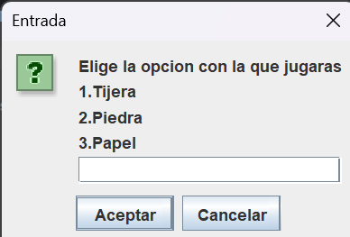
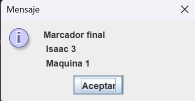
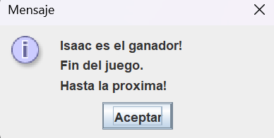

# Piedra, Papel o Tijeras | Java

Mi primer proyecto personal, desarrollado con Java, con el objetivo de mejorar
mi logica de programacion, y el uso de las estructuras de control.

## Descripcion

En el juego, el usuario competira contra la maquina para ganar un determinado
numero de rondas

Sera el usuario quien ingresara cuantas rondas habra que ganar para conseguir
la victoria definitiva. El juego termina hasta que exista un ganador.

## Caracteristicas

- Interfaz hecha mediante JOptionPane.
- Nombre personalizado para el usuario.
- Cantidad de victorias configurables.
- Elecciones aleatoria de la computadora.
- Deteccion de victorias, derrotas o empates.
- Validacion basica de entradas.
- Marcador final y anuncio del ganador.

## Capturas del juego

### Menu de opciones

### Marcador final

### Mensaje final

## Tecnologias
- Java.
- Java Swing.
- IntelliJ IDEA

## Como ejecutarlo

1. Descarga o clona este repositorio.
2. Abre el proyecto en un IDE compatible con Java.
3. Ejecuta el archivo 'Main.java'.
4. Sigue las instrucciones que aparecen en pantalla.

## Conocimientos aplicados
* Variables y operadores.
* Condicionales "if", "else if" y "else".
* Ciclos "While".
* Estructuras "Switch".
* Numeros aleatorios con "Math.random()".
* Entrada y salida con "JOptionPane".

## Mejoras futuras

- Manejo de entradas no numericas.
- Opcion para volver a jugar.
- Mejoras visuales.

## Autor

Isaac Espinoza.
Estudiante de Ingeniera en Desarrollo de Software.
Proyecto desarrollado como parte de mi aprendizaje de programacion en Java.